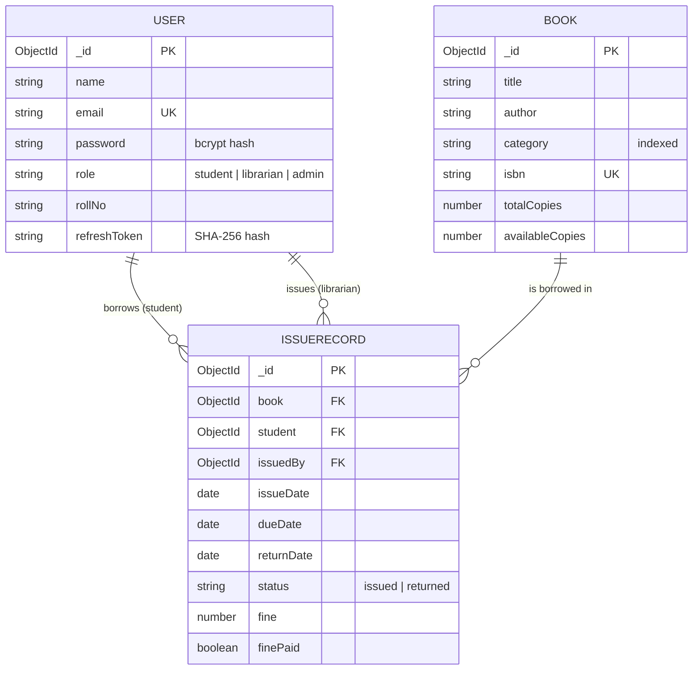

# ER diagram (renders on GitHub, or paste into https://mermaid.live)

Indexes: `User.email` (unique), `User.role`, `Book.isbn` (unique), `Book.category`, `Book.{title, author}`, `IssueRecord.{student, status}`, `IssueRecord.{status, dueDate}`.
